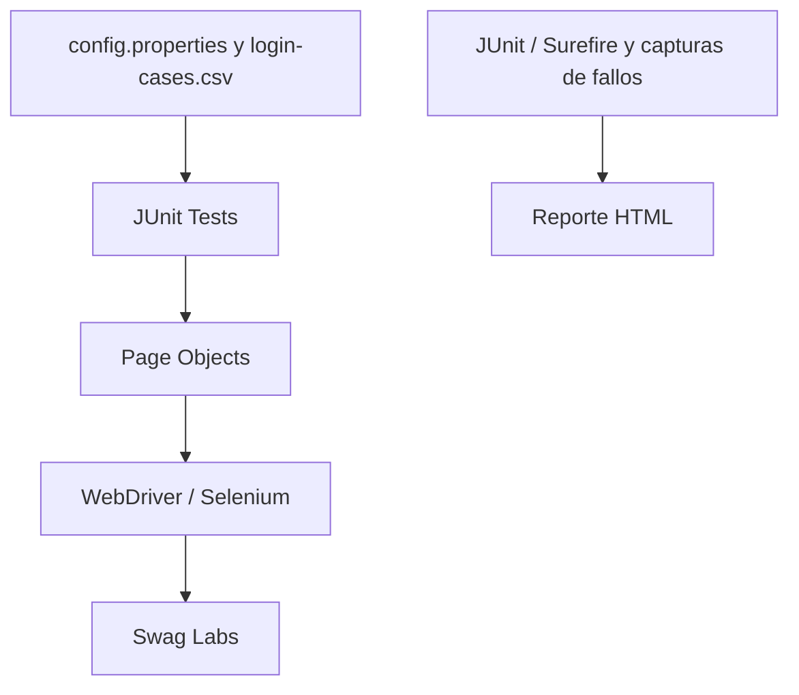

# Automatización de Swag Labs

Proyecto académico de pruebas web con Java, Selenium WebDriver, JUnit 5 y Maven. Se automatizan los cinco casos funcionales diseñados en el informe: TC01 a TC05.

## Requisitos

- JDK 17 o superior.
- Apache Maven 3.9 o superior.
- Google Chrome instalado para la configuración predeterminada.
- Acceso a `https://www.saucedemo.com/`.

Selenium Manager intenta localizar o descargar el controlador del navegador al crear el WebDriver.

## Ejecutar

Desde esta carpeta:

```bash
mvn clean test
mvn surefire-report:report
```

El reporte HTML se genera en `target/reports/surefire.html`; los resultados XML y de texto quedan en `target/surefire-reports/`. Si una prueba falla, se guarda una captura en `target/screenshots/` antes de cerrar el navegador.

Una copia del último reporte HTML y sus recursos queda disponible en `docs/evidencias/reporte-surefire/`.

El informe final entregable se encuentra en `docs/BISOFT32_Equipo_ProyectoFinal.pdf`.

## Casos automatizados

| ID | Cobertura | Verificación principal |
|---|---|---|
| TC01 | Inicio de sesión válido | Inventario y producto de referencia visibles |
| TC02 | Inicio de sesión con campos vacíos | Mensaje de validación y ausencia del inventario |
| TC03 | Usuario bloqueado | Mensaje de bloqueo y ausencia del inventario |
| TC04 | Agregar y quitar un producto del carrito | Botón, contador y producto dentro del carrito |
| TC05 | Ordenar productos por precio ascendente | Productos y precios en los límites del catálogo |

Las credenciales de acceso se encuentran en `src/test/resources/data/login-cases.csv`; la URL, el navegador y la espera se configuran en `src/test/resources/config.properties`. Cambiar `browser` permite seleccionar `chrome`, `firefox`, `edge` o `safari` si ese navegador está instalado y preparado para WebDriver.

## Arquitectura POM



## Decisiones técnicas

- Cada prueba abre y cierra su propio navegador; ninguna depende de otra prueba.
- Los selectores usan identificadores estables (`id` y `data-test` cuando aplica).
- Las esperas usan `WebDriverWait` con condiciones explícitas; no se utilizan pausas fijas.
- Los Page Objects contienen acciones y lecturas de la interfaz; las aserciones permanecen en las clases de prueba.
- Los datos de acceso se mantienen fuera del código, en un CSV de JUnit 5.
- Se automatizan los cinco casos definidos en el informe; no se incluye el flujo de compra porque no forma parte de esa selección.
- Las capturas automáticas se guardan únicamente si una prueba falla.
